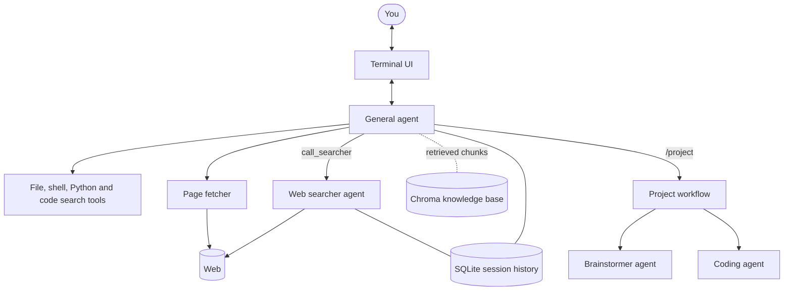
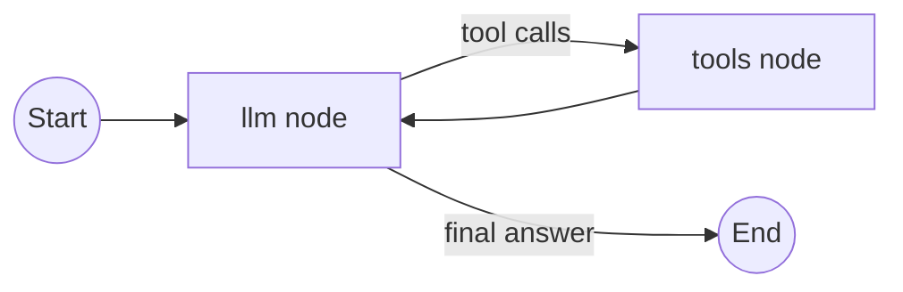
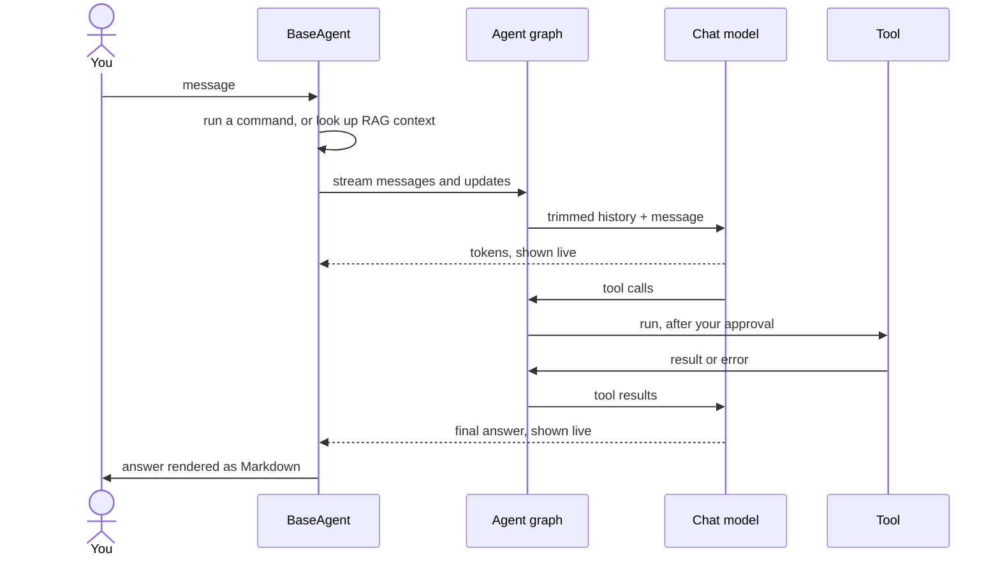

# Architecture

Ally is a Python application built on [LangGraph](https://langchain-ai.github.io/langgraph/) and [LangChain](https://python.langchain.com). Each agent is a small graph that alternates between a chat model and its tools. A terminal UI built with [Rich](https://rich.readthedocs.io) and [prompt_toolkit](https://python-prompt-toolkit.readthedocs.io) sits on top, and SQLite and Chroma provide local storage.

This page is for contributors and for anyone curious about how it fits together. For using Ally, start with [Getting started](getting-started.md).

- [Overview](#overview)
- [Startup](#startup)
- [Agents](#agents)
- [A chat turn](#a-chat-turn)
- [Tools and approval](#tools-and-approval)
- [Memory and sessions](#memory-and-sessions)
- [Web research](#web-research)
- [RAG](#rag)
- [Project workflow](#project-workflow)
- [Errors](#errors)
- [Code layout](#code-layout)

## Overview



Every agent is the same class, `BaseAgent`, configured with a system prompt, a set of tools and a model. Agents differ only in that configuration.

## Startup

`ally` runs `app.main:main`, which:

1. Parses the command line flags first, so `ally --help` and `ally --version` return without importing anything heavy.
2. Loads `.env` from the install folder, then reads and validates `config.json` (or `$ALLY_CONFIG`) with `app/config.py`. Validation collects every problem, such as an unknown provider or a missing key, and reports them together.
3. Builds the `CLI` (`app/src/cli/cli.py`), which creates the general and web searcher agents, sets up RAG if an embedding provider is configured and registers the chat commands.
4. Changes into the working directory and starts the chat loop.

Imports that are slow and often unused, such as the PDF and DOCX parsers and the Hugging Face libraries, happen the first time they are needed rather than at startup.

## Agents

An agent is described by an `AgentSpec` in `app/src/agents/registry.py`: the name of its prompt file in `app/prompts` and its tools. `AgentFactory` turns a spec and the agent's `AgentSettings` (provider, model, key, temperature and an optional custom prompt) into a `BaseAgent`.

`create_base_agent` builds the agent's graph:



- The **llm node** trims the history (see [Memory and sessions](#memory-and-sessions)), prepends the system prompt and calls the chat model with its tools bound.
- The **tools node** is `SequentialToolNode`, which runs the requested tools one at a time so that each approval prompt appears on its own.
- `create_chat_model` picks the LangChain chat model class for the provider. OpenAI and OpenRouter share `ChatOpenAI` with different base URLs. Anthropic, Google, Groq, Cerebras and Ollama use their own integrations.

Changing the model with `/model change` rebuilds the graph with the same prompt and tools. If the new model cannot be created, the old graph stays in place.

## A chat turn



`BaseAgent.start_chat` reads a line, then:

1. Handles it directly if it is a command (`/help`, `/model`, `/id` or one registered by the CLI, such as `/embed`) or a `!` shell command.
2. Otherwise, adds the working directory note and, when RAG is on, a separate message with the retrieved chunks.
3. Streams the graph with LangGraph's `messages` and `updates` modes. Tokens from the llm node go to `ResponseStream`, which shows a spinner until the first token and then the live tail of the reply. Updates mark tool calls and results. Tokens produced while the tools node runs are ignored, because they come from nested agents such as the web searcher.
4. Once the reply is complete, the live view is cleared and the full reply is printed as Markdown.

When input does not come from a terminal, the live view is skipped and only the final reply is printed.

## Tools and approval

Tools are LangChain tools defined in `app/src/tools`. Their docstrings are parsed in Google style and become the descriptions the model sees, including a description for every argument.

Tools that change things or read your files call `permission_manager.get_permission` before doing anything. It asks you through the UI and remembers "always" answers for the session. A denial raises `PermissionDeniedException`, which `SequentialToolNode` turns into a message for the model rather than an error. Other exceptions are also returned to the model as `Error: ...`, so it can correct a bad argument instead of ending the turn.

See [Tools and permissions](tools-and-permissions.md) for the full list.

## Memory and sessions

All agents share one `SqliteSaver` checkpointer stored in Ally's data directory. A session is a LangGraph thread, identified by the ID that `/id` shows. Resuming with `--id` or `/id <id>` loads that thread.

The full conversation is stored, but the model does not see all of it. Before each model call, `build_llm_context` keeps the current turn complete, with its tool calls and results, and condenses earlier history to the last 20 user messages and the text replies to them. Tool traffic and retrieved RAG chunks from earlier turns are dropped. This keeps long sessions inside the context window and keeps requests fast.

## Web research

`integrate_web_search` gives an agent a `call_searcher` tool. Calling it runs the web searcher agent on the question in a fresh thread, quietly, and returns its final answer as the tool result. The web searcher has its own prompt focused on recent, cited sources, and two tools: `search_and_scrape`, which searches with the keyless [ddgs](https://pypi.org/project/ddgs/) library and reads the top results in parallel, and `fetch_tool` for specific URLs.

Keeping research in a separate agent means the raw pages never enter the main conversation, only the summary does.

## RAG

The RAG code lives in `app/src/embeddings`:

- `DataBaseClient` wraps a persistent Chroma client. It keeps one Chroma collection per knowledge base and a small JSON file recording which ones are indexed.
- A scraper (`SimpleScraper`) turns a file into text and metadata. PDF and DOCX parsing is loaded on first use.
- An embedding function from `embedding_functions` turns text into vectors: Ollama, Hugging Face, OpenAI or NLP Cloud.

Embedding a folder hashes each file, skips unchanged ones, deletes the old chunks of changed ones and stores new chunks in batches. A query is embedded once, searched in every indexed collection and merged by distance. [RAG](rag.md) has the details from a user's point of view.

## Project workflow

`CodeGenUnit` in `app/src/orchestration/units` runs three agents in sequence, each in its own thread:

1. The **brainstormer** turns your idea into four context files: a blueprint, a roadmap, an implementation journal and a knowledge base.
2. Optionally, you chat with the brainstormer to add context.
3. The **coding agent** reads those files and builds the project, then stays open for an interactive session.

Each phase reports whether it finished, and the workflow stops at the first one that did not. When an agent reaches LangGraph's recursion limit, you are asked whether it should continue where it left off.

## Errors

Provider SDKs raise different exceptions for the same problem. `http_status` in `app/src/core/messages.py` maps LangChain's standard model errors and otherwise looks for a status code on the exception, its response and the exceptions it was raised from. The chat loop uses it to react sensibly:

- **404**: the model does not exist. If you just switched models, Ally switches back. Otherwise it offers to change the model.
- **429**: rate limited. Ally offers to change the model.
- **Anything else**: the error is shown in one line, the details go to the log file and the session stays open.

## Code layout

```text
app/
  main.py                    entry point: flags, .env, config, CLI
  config.py                  config.json loading and validation
  prompts/                   system prompts, one Markdown file per agent
  src/
    agents/registry.py       which prompt and tools each agent gets
    cli/                     the CLI session and command line flags
    core/
      base.py                BaseAgent: chat loop, commands, streaming, recovery
      create_base_agent.py   chat models, the agent graph, history trimming, checkpointer
      agent_factory.py       builds agents from settings
      messages.py            message text, HTTP status and error helpers
      permissions.py         tool approval
      shell.py               the shell used by ! commands
      ui.py                  terminal output, prompts and the live reply view
    tools/                   file, exec, find, git and web tools
    orchestration/           web research delegation and the project workflow
    embeddings/              knowledge base, scrapers and embedding functions
  utils/                     constants, paths, logging and UI messages
tests/                       pytest suite, using a scripted fake chat model
```
