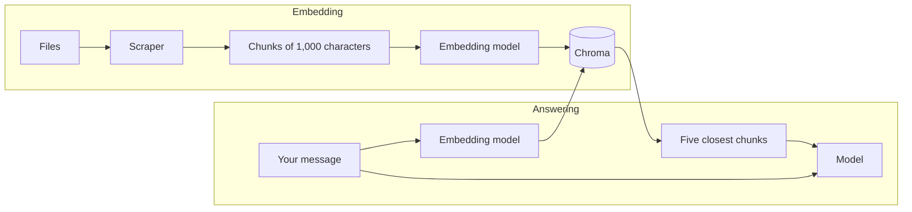

# RAG: chatting with your documents

Retrieval-augmented generation (RAG) lets Ally answer from your own files. Ally splits the files into chunks, turns each chunk into an embedding (a vector that captures its meaning) and stores them in a local [Chroma](https://www.trychroma.com) database. When RAG is on, each message you send is used to find the most relevant chunks, which are handed to the model along with your message.

- [Turn it on](#turn-it-on)
- [Build a knowledge base](#build-a-knowledge-base)
- [Ask questions](#ask-questions)
- [Manage collections](#manage-collections)
- [How it works](#how-it-works)
- [Troubleshooting](#troubleshooting)

## Turn it on

RAG needs an embedding provider in `config.json`:

```json
{
    "provider": "ollama",
    "model": "qwen3",
    "embedding_provider": "ollama",
    "embedding_model": "all-minilm"
}
```

### Embedding providers

| `embedding_provider` | Runs | Default `embedding_model` | Needs |
| --- | --- | --- | --- |
| `ollama` | locally | `all-minilm` | Ollama running, and `ollama pull all-minilm` |
| `hf` | locally | `sentence-transformers/all-MiniLM-L6-v2` | the `hf` extra (`./setup.sh --hf`) |
| `openai` | hosted | `text-embedding-3-small` | `OPENAI_API_KEY` |
| `nlp_cloud` | hosted | `paraphrase-multilingual-mpnet-base-v2` | `NLP_CLOUD_API_KEY` |

With `ollama` or `hf`, your documents never leave your machine. A Hugging Face model is downloaded the first time it is used and cached in Ally's data directory.

Without an embedding provider, the RAG commands only print a reminder to configure one.

## Build a knowledge base

Documents live in named collections. Add a file or a whole folder to a collection with `/embed`:

```text
> /embed ./handbook company-handbook
```

The path can be absolute or relative to the working directory. Ally reads every file under it, skipping the folders that `list_directory` does not expand (such as `.git` and `node_modules`), `.env` files and empty files.

| File type | How it is read |
| --- | --- |
| PDF | Converted to Markdown, keeping headings and tables. |
| DOCX | Text, tables, headers and footers. Tables become Markdown tables. |
| JSON, YAML, XML | Parsed and pretty-printed, so the structure is easy to follow. |
| Anything else | Read as text, guessing the encoding when it is not UTF-8. |

Running `/embed` again on the same path is cheap: files that have not changed are skipped, and changed files replace their old chunks. Use it whenever your documents change.

## Ask questions

Turn retrieval on, ask, and check which files the answer came from:

```text
> /start_rag
> What is the policy for remote work?
> /refs
```

While RAG is on, the model is told to answer only from the retrieved chunks and to say it does not know when they are not relevant, unless you allow it to use outside knowledge. `/refs` lists the files behind the latest answer. `/stop_rag` turns retrieval off again.

## Manage collections

| Command | What it does |
| --- | --- |
| `/list` | Lists collections and whether each one is indexed. |
| `/index <collection>` | Includes a collection in searches. New collections are indexed automatically. |
| `/unindex <collection>` | Leaves a collection out of searches without deleting it. |
| `/delete <collection>` | Deletes a collection. |
| `/purge` | Deletes every collection, after asking for confirmation. |

Indexing lets you keep several knowledge bases side by side and choose which ones Ally searches.

## How it works



- Text is split into chunks of 1,000 characters that overlap by 200, so a sentence cut at a boundary still appears whole in one chunk.
- Each chunk keeps the path of its file, its modification date and a hash of the file, which is how unchanged files are detected.
- A question is embedded once and compared against every indexed collection. The five closest chunks overall are kept, duplicates removed, and added to the conversation as a separate message.
- That message is dropped from the history once the turn is over, so earlier retrievals do not crowd out later ones.

The code is in [`app/src/embeddings`](../app/src/embeddings). [Architecture](architecture.md) shows how RAG fits into a chat turn.

## Troubleshooting

**Answers ignore the documents.** Check that RAG is on (`/start_rag`) and that the collection is indexed (`/list`). Then ask `/refs` after an answer: if no files are listed, nothing relevant was found. Rephrasing the question with words that appear in the documents often helps.

**Results got worse after changing `embedding_model`.** Vectors from different models cannot be compared, and Chroma rejects queries whose size does not match the collection. Rebuild each collection with `/delete` and `/embed` after switching models.

**A file failed to embed.** Ally shows the file name and carries on with the rest. The log file has the reason, for example a password-protected PDF. See [where Ally keeps its data](configuration.md#where-ally-keeps-its-data).

**Collections from Ally 0.7 give poor answers.** Older versions split documents into 50-character chunks. Rebuild those collections with `/delete` and `/embed`.
